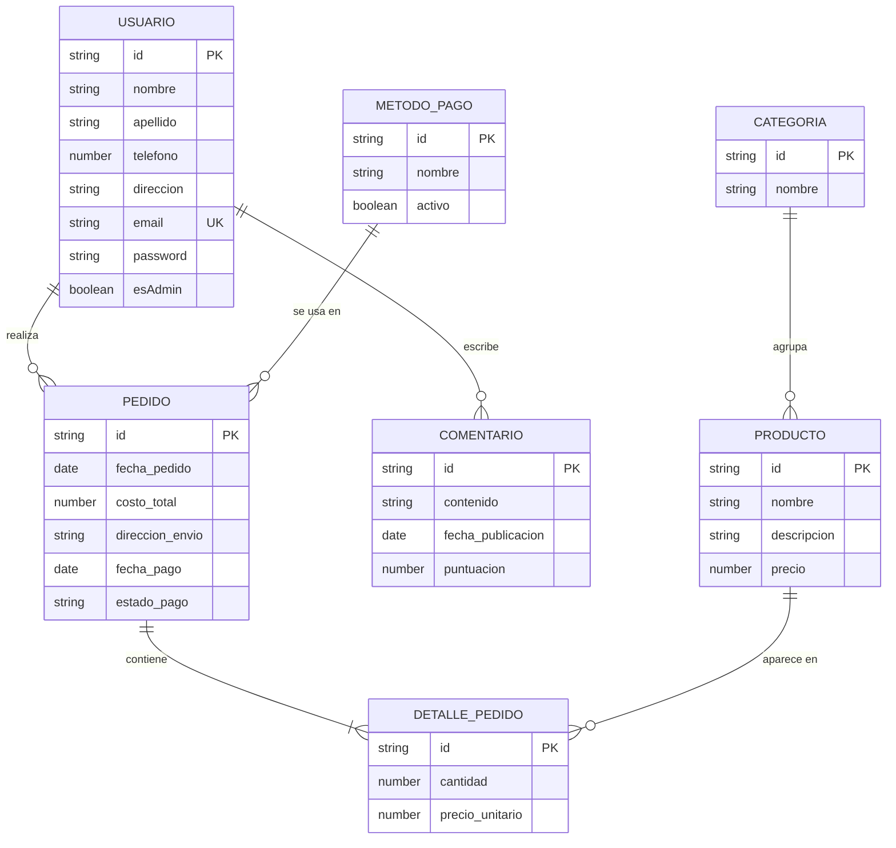

# Aroma Café - Cafetería de Especialidad

Trabajo Práctico de Desarrollo de Software (DSW).

## Grupo

### Integrantes

- 50026 - Vivas, Martin
- 49373 - Salvia, Camila
- 51337 - Leonardelli, Marianela

### Repositorio

- [Full stack app (monorepo: `backend/` + `frontend/`)](https://github.com/camila-salvia/red-de-cafeterias)

## Tema

### Descripción

Aplicación web de una cafetería. Los usuarios pueden registrarse, explorar el catálogo de productos por categoría, realizar pedidos y dejar reseñas. Los administradores gestionan categorías y productos, y consultan y confirman los pedidos de los clientes.

### Modelo



## Alcance funcional

| Req               | Detalle                                                                                                                                                                                                                                                                                                                                                   |
| :---------------- | :-------------------------------------------------------------------------------------------------------------------------------------------------------------------------------------------------------------------------------------------------------------------------------------------------------------------------------------------------------- |
| CRUD simple       | 1. CRUD Usuario<br>2. CRUD Categoría<br>3. CRUD Método de Pago                                                                                                                                                                                                                                                                                            |
| CRUD dependiente  | 1. CRUD Producto {depende de} CRUD Categoría<br>2. CRUD Detalle Pedido {depende de} CRUD Pedido, CRUD Producto<br>3. CRUD Pedido {depende de} CRUD Usuario, CRUD Método de pago<br>4. CRUD Comentario {depende de} CRUD Usuario                                                                                                                           |
| Listado + detalle | 1. Listado de productos pudiéndose filtrar por categoría en la pantalla de inicio.<br>2. Listado de pedidos pudiéndose filtrar por estado; al seleccionar un pedido se muestran los detalles del pedido.<br>3. Listado de productos, en el panel del administrador donde se observa el detalle de los productos, pudiendo editar o desactivar los mismos. |
| CUU/Epic          | 1. Realizar un pedido<br>2. Realizar comentarios siendo moderados con IA.<br>3. Agregar un producto al catálogo.<br>4. Administrar pedidos de clientes.                                                                                                                                                                                                   |

## Tecnologías

| Parte | Stack |
| :---- | :---- |
| Backend | Node.js 24, TypeScript 5.1, Express 5.2, MikroORM 6.6, MySQL 8.0, MySQL2, JWT, bcrypt, Mercado Pago SDK 3.6, Gemini API, Multer, dotenv y CORS |
| Frontend | Angular 21.2, Bootstrap 5.3, RxJS 7.8 y TypeScript 5.9 |
| Entorno y pruebas | npm, Node.js 24 y Vitest |

> MySQL es el motor de base de datos. `mysql2` es el controlador de MySQL que utiliza Node.js a través de MikroORM.

## Instalación y ejecución (local)

### 1. Requisitos previos

Instalar en la computadora:

- [Node.js](https://nodejs.org/) (versión LTS reciente; Angular 21 requiere Node 20.19+, 22.12+ o 24+) con `npm`.
- [MySQL](https://dev.mysql.com/downloads/) 8.0 o superior, en ejecución.
- [Git](https://git-scm.com/).

### 2. Clonar el repositorio

```bash
git clone https://github.com/camila-salvia/red-de-cafeterias.git
cd red-de-cafeterias
```

### 3. Backend

```bash
cd backend
npm install
```

**3.1 Variables de entorno.** Crear un archivo `.env` dentro de `backend/` con el siguiente contenido (ajustar los valores a tu MySQL local):

```env
DB_HOST=localhost
DB_PORT=3306
DB_USER=root
DB_PASSWORD=tu_password_de_mysql
DB_NAME=cafeteria

JWT_SECRET=genera_una_clave_secreta_larga

# Moderación de reseñas con Gemini
GEMINI_API_KEY=tu_api_key_de_gemini
GEMINI_MODEL=gemini-3.5-flash-lite
GEMINI_MODEL_FALLBACK=gemini-3.1-flash-lite,gemini-3.6-flash
GEMINI_THINKING_LEVEL=low
GEMINI_TIMEOUT_MS=20000
MODERACION_FALLA_ABIERTA=false

# Mercado Pago
MP_ACCESS_TOKEN=tu_access_token_de_mercado_pago
MP_WEBHOOK_SECRET=tu_clave_secreta_del_webhook

# URLs públicas necesarias para las redirecciones y notificaciones de pago
FRONTEND_URL=http://localhost:4200
BACKEND_URL=http://localhost:3000
```

`JWT_SECRET`, `GEMINI_API_KEY`, `MP_ACCESS_TOKEN` y `MP_WEBHOOK_SECRET` son credenciales privadas y no deben subirse al repositorio.

Descripción de las variables opcionales y especiales:

| Variable | Uso |
| :------- | :-- |
| `GEMINI_MODEL` | Modelo principal usado para moderar el texto de las reseñas. |
| `GEMINI_MODEL_FALLBACK` | Modelos alternativos separados por comas. |
| `GEMINI_THINKING_LEVEL` | Nivel de razonamiento opcional: `minimal`, `low`, `medium` o `high`. |
| `GEMINI_TIMEOUT_MS` | Tiempo máximo de espera por respuesta de Gemini. |
| `MODERACION_FALLA_ABIERTA` | Si es `true`, permite publicar un comentario si falla la moderación externa. El valor predeterminado seguro es `false`. |
| `MP_ACCESS_TOKEN` | Credencial de Mercado Pago para crear preferencias y consultar pagos. |
| `MP_WEBHOOK_SECRET` | Clave utilizada para verificar la firma de las notificaciones entrantes de Mercado Pago. |
| `FRONTEND_URL` | URL base del frontend, utilizada en las URLs de retorno del pago. |
| `BACKEND_URL` | URL base del backend, utilizada para registrar el webhook público en Mercado Pago. |

**3.2 Crear la base de datos.** Crear una base vacía con el mismo nombre que `DB_NAME`: cafeteria

```sql
CREATE DATABASE cafeteria;
```

**3.3 Crear las tablas.** En desarrollo (`npm run start:dev`) no hace falta ejecutar nada: al iniciar, el servidor sincroniza las tablas con las entidades de MikroORM (`syncSchema()` en `backend/src/app.ts`). Alcanza con que la base del paso anterior exista. En producción esto no ocurre: ver [Producción y cambios de esquema](#producción-y-cambios-de-esquema).

**3.4 Datos iniciales (seeds).** La aplicación necesita los siguientes datos para funcionar:

| Tabla                 | Datos                                              |
| :-------------------- | :------------------------------------------------- |
| Método de pago        | efectivo, transferencia, tarjeta; todos activos   |
| Categoría             | bebidas, comidas                                   |
| Usuario administrador | ver [credenciales](#credenciales-de-la-aplicación) |
| Usuario de prueba     | ver [credenciales](#credenciales-de-la-aplicación) |

Los datos iniciales se cargan automáticamente al iniciar el backend mediante `seedInitialData()` en `backend/src/shared/database/seed.ts`. El seed es idempotente: crea solo los registros inexistentes y no modifica ni elimina los datos existentes.

**3.5 Iniciar el servidor (modo desarrollo).**

```bash
npm run start:dev
```

Compila TypeScript en modo watch y levanta el servidor con `node ./dist/app.js`.

El backend queda disponible en **http://localhost:3000** y expone la API bajo `/api` (por ejemplo `http://localhost:3000/api/producto`).

Las imágenes de productos se guardan en `backend/uploads/productos/` y se sirven bajo `/uploads/productos/`. Se aceptan JPG, PNG y WebP de hasta 5 MB. En despliegues, ese directorio debe estar en almacenamiento persistente para conservar las imágenes.

Otros scripts disponibles en `backend/`:

| Script              | Descripción                                 |
| :------------------ | :------------------------------------------ |
| `npm run build`     | Compila el proyecto TypeScript a `dist/`    |
| `npm run start:dev` | Compila en modo watch y ejecuta el servidor |
| `npm test`          | Ejecuta las pruebas Vitest del backend     |
| `npm run schema:preview` | Muestra el SQL pendiente sin aplicarlo |
| `npm run schema:sync` | Aplica los cambios de esquema a la base configurada |

### 4. Frontend

En otra terminal, desde la raíz del repositorio:

```bash
cd frontend
npm install
npm start
```

La aplicación queda disponible en **http://localhost:4200**.

La URL de la API que consume el frontend se define en `frontend/src/environments/environment.ts` (`apiUrl`).

En desarrollo:

- El backend usa el puerto `3000`.
- El frontend usa el puerto `4200` definido por `npm start`.
- `frontend/src/environments/environment.development.ts` apunta a `http://localhost:3000/api`.
- `frontend/src/environments/environment.ts` contiene la configuración de producción y apunta a `https://red-de-cafeterias.onrender.com/api`.

Otros scripts disponibles en `frontend/`:

| Script          | Descripción                                      |
| :-------------- | :----------------------------------------------- |
| `npm start`     | Servidor de desarrollo (`ng serve`, puerto 4200) |
| `npm run build` | Build de producción en `dist/`                   |
| `npm run watch` | Build en modo watch (configuración development)  |
| `npm test`      | Ejecuta los tests                                |

Para ejecutar backend y frontend simultáneamente, usar dos terminales:

```bash
# Terminal 1
cd backend
npm run start:dev

# Terminal 2
cd frontend
npm start
```

Abrir el frontend en `http://localhost:4200`.

## Producción y cambios de esquema

Con `NODE_ENV=production` el backend **no** ejecuta `syncSchema()` al iniciar y no imprime las consultas SQL (`debug` del ORM desactivado). Los cambios de esquema se aplican a mano:

| Comando                  | Qué hace                                                                                    |
| :----------------------- | :------------------------------------------------------------------------------------------ |
| `npm run schema:preview` | Muestra el SQL pendiente sin ejecutarlo.                                                    |
| `npm run schema:sync`    | Aplica los cambios a la base configurada en `.env`. No borra tablas ni columnas existentes. |
| `npm start`              | Inicia el servidor compilado (`dist/app.js`).                                               |

Pasos para un deploy o una actualización:

1. `npm install` y `npm run build`.
2. Configurar las variables de entorno, con `NODE_ENV=production`.
3. `npm run schema:preview` para revisar y `npm run schema:sync` para aplicar. En el primer deploy, con la base vacía, este paso es obligatorio antes de iniciar el servidor.
4. `npm start`.

No es un sistema de migraciones versionadas: `schema:sync` solo agrega y modifica. Si se renombra o elimina una columna, hay que migrar los datos a mano.

## Deploy

| Componente                | URL          |
| :------------------------ | :----------- |
| Frontend                  | https://red-de-cafeterias-1.onrender.com/ |
| Backend / API             | https://red-de-cafeterias.onrender.com |
| Base de datos (proveedor) | https://railway.com/project/8783d861-1115-421e-8a4f-61430bd8314f/settings?environmentId=f976f52a-47d3-44b2-9022-b56f21eded93 |

La API pública comprobada responde en `https://red-de-cafeterias.onrender.com/api` y el frontend desplegado consume esa URL en su configuración de producción.

## Credenciales de la aplicación

Usuarios de prueba creados por el seed del backend local:

| Rol           | Email                   | Contraseña    |
| :------------ | :---------------------- | :------------ |
| Administrador | `admin@cafeteria.com`   | `password123` |
| Cliente       | `usuario@cafeteria.com` | `password123` |

El administrador accede al **Panel Admin** (alta, edición y baja de categorías y productos) y a **Pedidos de clientes** para consultar y confirmar pedidos pendientes. El cliente puede explorar productos, armar el carrito, cancelar pedidos pendientes y ver su historial.
