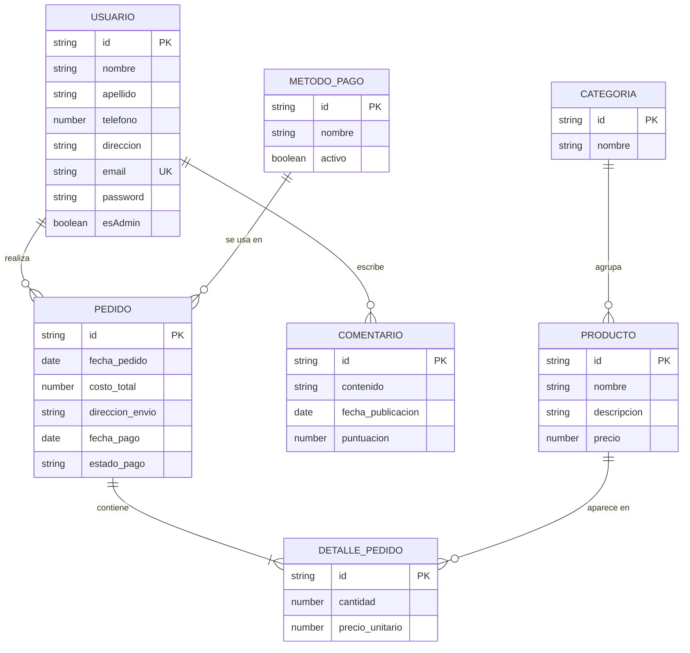

# CoffeMap – Red de Cafeterías

Trabajo Práctico de Desarrollo de Software (DSW).

## Grupo

### Integrantes

* 50026 - Vivas, Martin
* 49373 - Salvia, Camila
* 51337 - Leonardelli, Marianela

### Repositorio

* [Full stack app (monorepo: `backend/` + `frontend/`)](https://github.com/camila-salvia/red-de-cafeterias)

## Tema

### Descripción

Aplicación web de una cafetería. Los usuarios pueden registrarse, explorar el catálogo de productos por categoría, realizar pedidos y dejar reseñas. Los administradores gestionan categorías y productos desde un panel de administración.

### Modelo



## Alcance funcional

| Req | Detalle |
|:-|:-|
| CRUD simple | 1. CRUD Usuario<br>2. CRUD Categoría |
| CRUD dependiente | 1. CRUD Producto {depende de} CRUD Categoría<br>2. CRUD Detalle Pedido {depende de} CRUD Pedido, CRUD Producto<br>3. CRUD Pedido {depende de} CRUD Usuario, CRUD Método de pago<br>4. CRUD Comentario {depende de} CRUD Usuario |
| Listado + detalle | 1. Listado de productos por categoría (nombre y precio); al seleccionar un producto se accede al detalle con descripción y categoría.<br>2. Listado de pedidos filtrados por estado; al seleccionar un pedido se muestra la dirección de envío y el nombre del cliente. |
| CUU/Epic | 1. Realizar un pedido<br>2. Moderar comentarios con IA<br>3. Agregar un producto al catálogo |

## Tecnologías

| Parte | Stack |
|:-|:-|
| Backend | Node.js, TypeScript, Express 5, MikroORM 6, MySQL, JWT (jsonwebtoken), bcrypt |
| Frontend | Angular 21, Bootstrap 5, RxJS |

## Instalación y ejecución (local)

### 1. Requisitos previos

Instalar en la computadora:

* [Node.js](https://nodejs.org/) (versión LTS reciente; Angular 21 requiere Node 20.19+, 22.12+ o 24+) con `npm`.
* [MySQL](https://dev.mysql.com/downloads/) 8.0 o superior, en ejecución.
* [Git](https://git-scm.com/).

### 2. Clonar el repositorio

```bash
git clone https://github.com/camila-salvia/red-de-cafeterias.git
cd red-de-cafeterias
```

### 3. Backend

```bash
cd backend
npm install
```

**3.1 Variables de entorno.** Crear un archivo `.env` dentro de `backend/` con el siguiente contenido (ajustar los valores a tu MySQL local):

```env
DB_HOST=localhost
DB_PORT=3306
DB_USER=root
DB_PASSWORD=tu_password_de_mysql
DB_NAME=cafeteria
JWT_SECRET=una_clave_secreta
```

**3.2 Crear la base de datos.** Crear una base vacía con el mismo nombre que `DB_NAME`:

```sql
CREATE DATABASE cafeteria;
```

**3.3 Crear las tablas.** No hace falta ejecutar nada: las tablas se crean y actualizan automáticamente a partir de las entidades de MikroORM cada vez que se inicia el servidor (`syncSchema()` en `backend/src/app.ts`). Alcanza con que la base de datos del paso anterior exista.

**3.4 Datos iniciales (seeds).** La aplicación necesita los siguientes datos para funcionar:

| Tabla | Datos |
|:-|:-|
| Método de pago | efectivo, transferencia, tarjeta |
| Categoría | comida, bebida |
| Usuario administrador | ver [credenciales](#credenciales-de-la-aplicación) |

> ⚠️ COMPLETAR: indicar cómo se cargan (script SQL, script de seed, o carga manual).

**3.5 Iniciar el servidor (modo desarrollo).**

```bash
npm run start:dev
```

Compila TypeScript en modo watch y levanta el servidor con `node ./dist/app.js`.

El backend queda disponible en **http://localhost:3000** y expone la API bajo `/api` (por ejemplo `http://localhost:3000/api/producto`).

Otros scripts disponibles en `backend/`:

| Script | Descripción |
|:-|:-|
| `npm run build` | Compila el proyecto TypeScript a `dist/` |
| `npm run start:dev` | Compila en modo watch y ejecuta el servidor |

### 4. Frontend

En otra terminal, desde la raíz del repositorio:

```bash
cd frontend
npm install
npm start
```

La aplicación queda disponible en **http://localhost:3000**.

La URL de la API que consume el frontend se define en `frontend/src/environments/environment.ts` (`apiUrl`).

> ⚠️ COMPLETAR: valor de `apiUrl` y puerto del frontend para desarrollo local. Hoy `environment.ts` apunta a `https://api.tucafeteria.com/api` y tanto el backend como `npm start` del frontend usan el puerto 3000, por lo que no pueden correr a la vez.

Otros scripts disponibles en `frontend/`:

| Script | Descripción |
|:-|:-|
| `npm start` | Servidor de desarrollo (`ng serve`, puerto 3000) |
| `npm run build` | Build de producción en `dist/` |
| `npm run watch` | Build en modo watch (configuración development) |
| `npm test` | Ejecuta los tests |

## Deploy

| Componente | URL |
|:-|:-|
| Frontend | ⚠️ COMPLETAR |
| Backend / API | ⚠️ COMPLETAR |
| Base de datos (proveedor) | ⚠️ COMPLETAR |

## Credenciales de la aplicación

Usuarios de prueba para ingresar a la aplicación deployada:

| Rol | Email | Contraseña |
|:-|:-|:-|
| Administrador | `admin@cafeteria.com` | `password123` |
| Cliente | ⚠️ COMPLETAR | ⚠️ COMPLETAR |

El administrador accede al **Panel Admin** (alta, edición y baja de categorías y productos). El cliente puede explorar productos, armar el carrito, confirmar pedidos y ver su historial.
